# THIẾT KẾ CƠ SỞ DỮ LIỆU CHUẨN HÓA KHÁM PHÁ (EXPLORE DATABASE SCHEMA - REVISED)

> **Hệ quản trị CSDL:** PostgreSQL 16 + PostGIS 3.4  
> **Nền tảng triển khai:** Supabase (PostgreSQL, Row Level Security, Edge Functions)  
> **Phiên bản:** 2.0 (Chuẩn hóa thực thể quan hệ, hỗ trợ xuyên quốc gia, trường nullable thực tế và bảo mật RLS)

---

## 1. SƠ ĐỒ THỰC THỂ QUAN HỆ SỬA ĐỔI (REVISED ERD)

```mermaid
erDiagram
    continents ||--o{ countries : "contains"
    countries ||--o{ regions : "subdivided_into"
    countries ||--o{ destination_countries : "locates"
    countries ||--o{ route_countries : "traversed_by"
    
    destinations ||--o{ destination_countries : "spans"
    destinations ||--o{ destination_regions : "belongs_to"
    destinations ||--o{ trekking_routes : "contains"
    destinations ||--o{ points_of_interest : "encloses"
    destinations ||--o{ destination_media : "has_media"
    destinations ||--o{ destination_category_map : "classified_as"
    destinations ||--o{ destination_source_records : "provenance"
    destinations ||--o{ destination_live_snapshots : "captures"

    destination_categories ||--o{ destination_category_map : "maps_to"
    
    trekking_routes ||--o{ route_countries : "spans"
    trekking_routes ||--o{ route_stages : "divided_into"
    trekking_routes ||--o{ points_of_interest : "passes_through"
    trekking_routes ||--o{ safety_guidelines : "has_guidelines"

    continents {
        varchar(20) id PK "asia, europe, north_america, etc."
        varchar(100) name "Châu Á, Châu Âu"
        varchar(100) english_name "Asia, Europe"
        int sort_order
    }

    countries {
        varchar(2) id PK "ISO 3166-1 alpha-2: VN, JP, CH, FR, etc."
        varchar(20) continent_id FK
        varchar(100) name "Tên tiếng Việt"
        varchar(100) english_name "English Name"
        varchar(20) emergency_police "113, 110, 911, 112"
        varchar(20) emergency_ambulance "115, 119, 911, 112"
        varchar(20) emergency_fire "114, 119, 911, 112"
        varchar(50) emergency_mountain_rescue "Số cứu hộ núi (REGA, Kiểm lâm)"
        varchar(10) default_currency "VND, JPY, CHF, EUR"
    }

    regions {
        varchar(50) id PK "vn_north, ch_valais, etc."
        varchar(2) country_id FK
        varchar(100) name "Miền Bắc, Bang Valais"
        varchar(50) region_type "macro_region, province, state"
        int sort_order
    }

    destinations {
        uuid id PK "gen_random_uuid()"
        varchar(120) slug UK "ta-nang-phan-dung, tour-du-mont-blanc"
        varchar(255) name "Tên điểm đến"
        varchar(255) local_name "Tên bản địa (nullable)"
        double_precision center_latitude "Tọa độ tâm (nullable)"
        double_precision center_longitude "Tọa độ tâm (nullable)"
        geometry center_geom "Point, SRID 4326 (nullable)"
        int elevation_meters "Độ cao tham chiếu (nullable)"
        text editorial_summary "Tóm tắt biên tập"
        text editorial_content "Bài viết chi tiết (nullable)"
        text_array best_travel_seasons "Tháng lý tưởng (nullable)"
        boolean is_featured "Nổi bật"
        boolean is_verified "Kiểm chứng thực địa"
        date verification_date "Ngày kiểm duyệt (nullable)"
        varchar(20) status "draft, published, archived"
        timestamptz created_at
        timestamptz updated_at
        timestamptz deleted_at "Soft delete (nullable)"
    }

    destination_countries {
        uuid destination_id PK, FK
        varchar(2) country_id PK, FK
        boolean is_primary "Quốc gia chính"
    }

    trekking_routes {
        uuid id PK "gen_random_uuid()"
        uuid destination_id FK
        varchar(255) name "Tên cung đường"
        numeric distance_km "Cự ly đo đạc km (nullable)"
        int elevation_gain_meters "Độ dốc tích lũy m (nullable)"
        smallint difficulty_level "1..4 (nullable)"
        smallint estimated_duration_days "Số ngày dự kiến (nullable)"
        text gpx_track_url "Link file GPX chuẩn (nullable)"
        boolean is_verified "Kiểm duyệt chuyên gia"
        date verification_date "Ngày kiểm duyệt (nullable)"
        varchar(20) status "draft, published, archived"
        timestamptz created_at
        timestamptz updated_at
    }

    route_stages {
        uuid id PK "gen_random_uuid()"
        uuid route_id FK
        smallint stage_number "1, 2, 3..."
        varchar(255) title "Tên chặng"
        text description "Mô tả chặng"
        numeric distance_km "Cự ly chặng (nullable)"
        int elevation_gain_meters "Độ dốc chặng (nullable)"
        varchar(100) terrain_type "Rừng rậm, Sống lưng, Đèo dốc"
    }

    safety_guidelines {
        uuid id PK "gen_random_uuid()"
        uuid route_id FK "Liên kết cung đường cụ thể"
        text water_advice "Khuyến cáo nguồn nước thực địa"
        text mobile_coverage_summary "Tình trạng sóng di động đo đạc"
        text_array primary_hazards "Danh sách hiểm họa (Lũ quét, Sét, Rắn)"
        text_array required_gear "Trang bị bắt buộc"
        text emergency_contact_info "Thông tin liên hệ cứu hộ cụ thể"
        date verification_date "Ngày chuyên gia kiểm duyệt"
        varchar(150) verified_by "Tên chuyên gia/tổ chức kiểm duyệt"
        timestamptz updated_at
    }

    points_of_interest {
        uuid id PK "gen_random_uuid()"
        uuid destination_id FK "nullable"
        uuid route_id FK "nullable"
        varchar(255) name "Tên POI"
        varchar(50) poi_type "summit, water_source, campsite, ranger_station, clinic, hazard"
        double_precision latitude
        double_precision longitude
        geometry geom "Point, SRID 4326"
        int elevation_meters "nullable"
        varchar(50) verification_status "unverified_osm, verified_field"
        varchar(50) emergency_phone "nullable"
        text notes "Lưu ý an toàn thực địa"
        timestamptz created_at
    }
```



---

## 2. DDL KHẢ THI TRÊN POSTGRESQL 16 & POSTGIS

```sql
-- Kích hoạt extension
CREATE EXTENSION IF NOT EXISTS "uuid-ossp";
CREATE EXTENSION IF NOT EXISTS "postgis";

-- 1. BẢNG CHÂU LỤC (continents)
CREATE TABLE continents (
    id VARCHAR(20) PRIMARY KEY, -- 'asia', 'europe', 'north_america', 'south_america', 'oceania', 'africa', 'antarctica'
    name VARCHAR(100) NOT NULL,
    english_name VARCHAR(100) NOT NULL,
    sort_order INT DEFAULT 0 NOT NULL
);

-- 2. BẢNG QUỐC GIA (countries)
CREATE TABLE countries (
    id VARCHAR(2) PRIMARY KEY, -- ISO 3166-1 alpha-2: 'VN', 'JP', 'CH', 'FR', 'IT', 'US', 'CA', 'NZ'
    continent_id VARCHAR(20) NOT NULL REFERENCES continents(id) ON DELETE RESTRICT,
    name VARCHAR(100) NOT NULL,
    english_name VARCHAR(100) NOT NULL,
    emergency_police VARCHAR(20) DEFAULT '112' NOT NULL,
    emergency_ambulance VARCHAR(20) DEFAULT '112' NOT NULL,
    emergency_fire VARCHAR(20) DEFAULT '112' NOT NULL,
    emergency_mountain_rescue VARCHAR(50), -- Số cứu hộ chuyên dụng: VD Thụy Sĩ '1414', VN '114'
    default_currency VARCHAR(10) DEFAULT 'USD' NOT NULL,
    created_at TIMESTAMPTZ DEFAULT CURRENT_TIMESTAMP NOT NULL
);

-- 3. BẢNG VÙNG MIỀN / HÀNH CHÍNH (regions)
CREATE TABLE regions (
    id VARCHAR(50) PRIMARY KEY, -- 'vn_north', 'vn_highlands', 'ch_valais', 'us_california'
    country_id VARCHAR(2) NOT NULL REFERENCES countries(id) ON DELETE CASCADE,
    name VARCHAR(100) NOT NULL,
    region_type VARCHAR(50) DEFAULT 'macro_region' NOT NULL,
    sort_order INT DEFAULT 0 NOT NULL
);

-- 4. BẢNG DANH MỤC HOẠT ĐỘNG (destination_categories)
CREATE TABLE destination_categories (
    id VARCHAR(50) PRIMARY KEY, -- 'trekking', 'camping', 'waterfalls', 'passes', 'beaches', 'national_parks', 'heritage'
    name VARCHAR(100) NOT NULL,
    english_name VARCHAR(100) NOT NULL,
    icon_name VARCHAR(50) NOT NULL,
    sort_order INT DEFAULT 0 NOT NULL
);

-- 5. BẢNG ĐIỂM ĐẾN / KHU VỰC DU LỊCH (destinations)
CREATE TABLE destinations (
    id UUID PRIMARY KEY DEFAULT uuid_generate_v4(),
    slug VARCHAR(120) NOT NULL UNIQUE,
    name VARCHAR(255) NOT NULL,
    local_name VARCHAR(255),
    center_latitude DOUBLE PRECISION CHECK (center_latitude BETWEEN -90.0 AND 90.0),
    center_longitude DOUBLE PRECISION CHECK (center_longitude BETWEEN -180.0 AND 180.0),
    center_geom GEOMETRY(Point, 4326),
    elevation_meters INT CHECK (elevation_meters BETWEEN -500 AND 9000), -- Nullable: điểm đến văn hóa/biển không bắt buộc có độ cao
    editorial_summary TEXT NOT NULL,
    editorial_content TEXT,
    best_travel_seasons TEXT[] DEFAULT '{}',
    is_featured BOOLEAN DEFAULT false NOT NULL,
    is_verified BOOLEAN DEFAULT false NOT NULL,
    verification_date DATE,
    status VARCHAR(20) DEFAULT 'published' NOT NULL CHECK (status IN ('draft', 'published', 'archived')),
    created_at TIMESTAMPTZ DEFAULT CURRENT_TIMESTAMP NOT NULL,
    updated_at TIMESTAMPTZ DEFAULT CURRENT_TIMESTAMP NOT NULL,
    deleted_at TIMESTAMPTZ -- Soft delete
);

-- 6. BẢNG TRUNG GIAN ĐIỂM ĐẾN - QUỐC GIA (destination_countries)
-- Cho phép 1 điểm đến thuộc nhiều quốc gia (Alps, Tour du Mont Blanc)
CREATE TABLE destination_countries (
    destination_id UUID NOT NULL REFERENCES destinations(id) ON DELETE CASCADE,
    country_id VARCHAR(2) NOT NULL REFERENCES countries(id) ON DELETE RESTRICT,
    is_primary BOOLEAN DEFAULT true NOT NULL,
    PRIMARY KEY (destination_id, country_id)
);

-- 7. BẢNG TRUNG GIAN ĐIỂM ĐẾN - VÙNG MIỀN (destination_regions)
CREATE TABLE destination_regions (
    destination_id UUID NOT NULL REFERENCES destinations(id) ON DELETE CASCADE,
    region_id VARCHAR(50) NOT NULL REFERENCES regions(id) ON DELETE CASCADE,
    PRIMARY KEY (destination_id, region_id)
);

-- 8. BẢNG TRUNG GIAN ĐIỂM ĐẾN - DANH MỤC (destination_category_map)
CREATE TABLE destination_category_map (
    destination_id UUID NOT NULL REFERENCES destinations(id) ON DELETE CASCADE,
    category_id VARCHAR(50) NOT NULL REFERENCES destination_categories(id) ON DELETE CASCADE,
    is_primary BOOLEAN DEFAULT false NOT NULL,
    PRIMARY KEY (destination_id, category_id)
);

-- 9. BẢNG CUNG ĐƯỜNG DÃ NGOẠI / TREKKING (trekking_routes)
-- Chuẩn hóa tách rời khỏi destinations: Một điểm đến có thể có 0 hoặc nhiều cung đường
CREATE TABLE trekking_routes (
    id UUID PRIMARY KEY DEFAULT uuid_generate_v4(),
    destination_id UUID NOT NULL REFERENCES destinations(id) ON DELETE CASCADE,
    name VARCHAR(255) NOT NULL,
    distance_km NUMERIC(6, 1) CHECK (distance_km >= 0), -- Nullable nếu chưa đo đạc chính xác
    elevation_gain_meters INT CHECK (elevation_gain_meters >= 0),
    difficulty_level SMALLINT CHECK (difficulty_level BETWEEN 1 AND 4), -- 1: Dễ, 2: Vừa, 3: Khó, 4: Thách thức
    estimated_duration_days SMALLINT CHECK (estimated_duration_days BETWEEN 1 AND 60),
    gpx_track_url TEXT,
    is_verified BOOLEAN DEFAULT false NOT NULL,
    verification_date DATE,
    status VARCHAR(20) DEFAULT 'published' NOT NULL CHECK (status IN ('draft', 'published', 'archived')),
    created_at TIMESTAMPTZ DEFAULT CURRENT_TIMESTAMP NOT NULL,
    updated_at TIMESTAMPTZ DEFAULT CURRENT_TIMESTAMP NOT NULL
);

-- 10. BẢNG TRUNG GIAN CUNG ĐƯỜNG - QUỐC GIA (route_countries)
CREATE TABLE route_countries (
    route_id UUID NOT NULL REFERENCES trekking_routes(id) ON DELETE CASCADE,
    country_id VARCHAR(2) NOT NULL REFERENCES countries(id) ON DELETE RESTRICT,
    PRIMARY KEY (route_id, country_id)
);

-- 11. BẢNG CÁC CHẶNG LỘ TRÌNH (route_stages)
CREATE TABLE route_stages (
    id UUID PRIMARY KEY DEFAULT uuid_generate_v4(),
    route_id UUID NOT NULL REFERENCES trekking_routes(id) ON DELETE CASCADE,
    stage_number SMALLINT NOT NULL CHECK (stage_number > 0),
    title VARCHAR(255) NOT NULL,
    description TEXT NOT NULL,
    distance_km NUMERIC(5, 1) CHECK (distance_km >= 0),
    elevation_gain_meters INT,
    terrain_type VARCHAR(100), -- 'Rừng khộp', 'Sống lưng trơ', 'Rừng rêu ma mị'
    created_at TIMESTAMPTZ DEFAULT CURRENT_TIMESTAMP NOT NULL,
    UNIQUE (route_id, stage_number)
);

-- 12. BẢNG QUY TẮC AN TOÀN SINH TỒN THỰC ĐỊA (safety_guidelines)
CREATE TABLE safety_guidelines (
    id UUID PRIMARY KEY DEFAULT uuid_generate_v4(),
    route_id UUID NOT NULL UNIQUE REFERENCES trekking_routes(id) ON DELETE CASCADE,
    water_advice TEXT NOT NULL, -- Khuyến cáo nguồn nước thực tế (VD: bắt buộc mang tối thiểu 2.5L, suối cạn tháng 3-5)
    mobile_coverage_summary TEXT NOT NULL, -- Thực tế đo đạc sóng (VD: Mất sóng 70%, chỉ có sóng tại mốc km12)
    primary_hazards TEXT[] DEFAULT '{}' NOT NULL, -- Mảng hiểm họa chính: Lũ quét, Rắn độc, Sốc nhiệt, Lạc đường
    required_gear TEXT[] DEFAULT '{}' NOT NULL, -- Trang bị bắt buộc
    emergency_contact_info TEXT NOT NULL, -- Liên hệ cứu hộ cụ thể cho cung này
    verification_date DATE NOT NULL,
    verified_by VARCHAR(150) NOT NULL,
    updated_at TIMESTAMPTZ DEFAULT CURRENT_TIMESTAMP NOT NULL
);

-- 13. BẢNG ĐIỂM TIỆN ÍCH, NGUỒN NƯỚC & CỨU HỘ (points_of_interest)
CREATE TABLE points_of_interest (
    id UUID PRIMARY KEY DEFAULT uuid_generate_v4(),
    destination_id UUID REFERENCES destinations(id) ON DELETE CASCADE,
    route_id UUID REFERENCES trekking_routes(id) ON DELETE SET NULL,
    name VARCHAR(255) NOT NULL,
    poi_type VARCHAR(50) NOT NULL CHECK (poi_type IN ('summit', 'water_source', 'campsite', 'ranger_station', 'medical_clinic', 'hazard_spot')),
    latitude DOUBLE PRECISION NOT NULL CHECK (latitude BETWEEN -90.0 AND 90.0),
    longitude DOUBLE PRECISION NOT NULL CHECK (longitude BETWEEN -180.0 AND 180.0),
    geom GEOMETRY(Point, 4326),
    elevation_meters INT,
    verification_status VARCHAR(50) DEFAULT 'unverified_osm' NOT NULL CHECK (verification_status IN ('unverified_osm', 'verified_field')),
    emergency_phone VARCHAR(50),
    notes TEXT,
    created_at TIMESTAMPTZ DEFAULT CURRENT_TIMESTAMP NOT NULL
);

-- 14. BẢNG QUẢN LÝ HÌNH ẢNH & BẢN QUYỀN (destination_media)
CREATE TABLE destination_media (
    id UUID PRIMARY KEY DEFAULT uuid_generate_v4(),
    destination_id UUID NOT NULL REFERENCES destinations(id) ON DELETE CASCADE,
    route_id UUID REFERENCES trekking_routes(id) ON DELETE SET NULL,
    media_type VARCHAR(20) DEFAULT 'photo' NOT NULL CHECK (media_type IN ('photo', 'panorama', 'topo_map')),
    image_url TEXT NOT NULL,
    thumbnail_url TEXT,
    local_asset_path TEXT,
    photographer VARCHAR(150) NOT NULL,
    source_name VARCHAR(100) NOT NULL, -- 'Wikimedia Commons', 'Unsplash', 'Field Ranger'
    source_url TEXT,
    license VARCHAR(50) NOT NULL, -- 'CC-BY-4.0', 'CC-BY-SA-4.0', 'Public Domain', 'Unsplash License'
    attribution TEXT NOT NULL,
    aspect_ratio NUMERIC(4, 3) DEFAULT 1.777 NOT NULL,
    focal_point VARCHAR(20) DEFAULT 'center' NOT NULL,
    is_hero BOOLEAN DEFAULT false NOT NULL,
    sort_order INT DEFAULT 0 NOT NULL,
    created_at TIMESTAMPTZ DEFAULT CURRENT_TIMESTAMP NOT NULL
);

-- 15. BẢNG ĐỊNH DANH NHÀ CUNG CẤP DỮ LIỆU (data_sources)
CREATE TABLE data_sources (
    id VARCHAR(50) PRIMARY KEY, -- 'open_meteo', 'overpass_osm', 'esri', 'wikimedia', 'unesco'
    provider_name VARCHAR(100) NOT NULL,
    api_base_url TEXT NOT NULL,
    terms_url TEXT,
    requires_attribution BOOLEAN DEFAULT true NOT NULL,
    rate_limit_per_min INT
);

-- 16. BẢNG TRUY NGUYÊN NGUỒN GỐC BẢN GHI (destination_source_records)
CREATE TABLE destination_source_records (
    id UUID PRIMARY KEY DEFAULT uuid_generate_v4(),
    destination_id UUID REFERENCES destinations(id) ON DELETE CASCADE,
    route_id UUID REFERENCES trekking_routes(id) ON DELETE CASCADE,
    data_source_id VARCHAR(50) NOT NULL REFERENCES data_sources(id) ON DELETE RESTRICT,
    external_id VARCHAR(150),
    external_url TEXT,
    raw_payload JSONB,
    last_synced_at TIMESTAMPTZ DEFAULT CURRENT_TIMESTAMP NOT NULL,
    sync_status VARCHAR(20) DEFAULT 'success' NOT NULL CHECK (sync_status IN ('success', 'failed', 'stale'))
);

-- 17. BẢNG LƯU SNAPSHOT THỜI GIAN THỰC (destination_live_snapshots)
CREATE TABLE destination_live_snapshots (
    id UUID PRIMARY KEY DEFAULT uuid_generate_v4(),
    destination_id UUID REFERENCES destinations(id) ON DELETE CASCADE,
    route_id UUID REFERENCES trekking_routes(id) ON DELETE CASCADE,
    provider_code VARCHAR(50) NOT NULL,
    snapshot_type VARCHAR(50) NOT NULL CHECK (snapshot_type IN ('weather_forecast', 'nearby_pois')),
    payload JSONB NOT NULL,
    fetched_at TIMESTAMPTZ DEFAULT CURRENT_TIMESTAMP NOT NULL,
    expires_at TIMESTAMPTZ NOT NULL
);
```

---

## 3. THIẾT KẾ CHỈ MỤC & TRIGGERS (INDEXES & TRIGGERS)

```sql
-- 1. Trigger tự động tính toán PostGIS geom cho destination và POI
CREATE OR REPLACE FUNCTION fn_sync_point_geom()
RETURNS TRIGGER AS $$
BEGIN
    IF NEW.latitude IS NOT NULL AND NEW.longitude IS NOT NULL THEN
        NEW.geom := ST_SetSRID(ST_MakePoint(NEW.longitude, NEW.latitude), 4326);
    END IF;
    RETURN NEW;
END;
$$ LANGUAGE plpgsql;

CREATE TRIGGER trg_poi_geom
BEFORE INSERT OR UPDATE OF latitude, longitude ON points_of_interest
FOR EACH ROW EXECUTE FUNCTION fn_sync_point_geom();

CREATE OR REPLACE FUNCTION fn_sync_dest_geom()
RETURNS TRIGGER AS $$
BEGIN
    IF NEW.center_latitude IS NOT NULL AND NEW.center_longitude IS NOT NULL THEN
        NEW.center_geom := ST_SetSRID(ST_MakePoint(NEW.center_longitude, NEW.center_latitude), 4326);
    END IF;
    NEW.updated_at := CURRENT_TIMESTAMP;
    RETURN NEW;
END;
$$ LANGUAGE plpgsql;

CREATE TRIGGER trg_dest_geom
BEFORE INSERT OR UPDATE OF center_latitude, center_longitude ON destinations
FOR EACH ROW EXECUTE FUNCTION fn_sync_dest_geom();

-- 2. Chỉ mục không gian PostGIS (GIST Indexes)
CREATE INDEX idx_destinations_center_geom ON destinations USING GIST (center_geom);
CREATE INDEX idx_pois_geom ON points_of_interest USING GIST (geom);

-- 3. Chỉ mục khóa ngoại và lọc phổ biến (B-Tree Indexes)
CREATE INDEX idx_dest_countries_country ON destination_countries (country_id);
CREATE INDEX idx_route_dest ON trekking_routes (destination_id);
CREATE INDEX idx_route_countries_country ON route_countries (country_id);
CREATE INDEX idx_media_destination ON destination_media (destination_id, is_hero);
CREATE INDEX idx_pois_dest_route ON points_of_interest (destination_id, route_id);
CREATE INDEX idx_snapshots_expires ON destination_live_snapshots (expires_at);
```

---

## 4. CHÍNH SÁCH BẢO MẬT ROW LEVEL SECURITY (RLS POLICIES)

```sql
-- Kích hoạt RLS cho toàn bộ các bảng dữ liệu
ALTER TABLE continents ENABLE ROW LEVEL SECURITY;
ALTER TABLE countries ENABLE ROW LEVEL SECURITY;
ALTER TABLE regions ENABLE ROW LEVEL SECURITY;
ALTER TABLE destination_categories ENABLE ROW LEVEL SECURITY;
ALTER TABLE destinations ENABLE ROW LEVEL SECURITY;
ALTER TABLE destination_countries ENABLE ROW LEVEL SECURITY;
ALTER TABLE destination_regions ENABLE ROW LEVEL SECURITY;
ALTER TABLE destination_category_map ENABLE ROW LEVEL SECURITY;
ALTER TABLE trekking_routes ENABLE ROW LEVEL SECURITY;
ALTER TABLE route_countries ENABLE ROW LEVEL SECURITY;
ALTER TABLE route_stages ENABLE ROW LEVEL SECURITY;
ALTER TABLE safety_guidelines ENABLE ROW LEVEL SECURITY;
ALTER TABLE points_of_interest ENABLE ROW LEVEL SECURITY;
ALTER TABLE destination_media ENABLE ROW LEVEL SECURITY;
ALTER TABLE data_sources ENABLE ROW LEVEL SECURITY;
ALTER TABLE destination_source_records ENABLE ROW LEVEL SECURITY;
ALTER TABLE destination_live_snapshots ENABLE ROW LEVEL SECURITY;

-- 1. Quyền đọc công khai (Public Read Only cho Client đã Published và chưa bị xóa mềm)
CREATE POLICY "Public Read Continents" ON continents FOR SELECT USING (true);
CREATE POLICY "Public Read Countries" ON countries FOR SELECT USING (true);
CREATE POLICY "Public Read Regions" ON regions FOR SELECT USING (true);
CREATE POLICY "Public Read Categories" ON destination_categories FOR SELECT USING (true);

CREATE POLICY "Public Read Published Destinations" ON destinations 
FOR SELECT USING (status = 'published' AND deleted_at IS NULL);

CREATE POLICY "Public Read DestinationCountries" ON destination_countries FOR SELECT USING (true);
CREATE POLICY "Public Read DestinationRegions" ON destination_regions FOR SELECT USING (true);
CREATE POLICY "Public Read DestinationCategoryMap" ON destination_category_map FOR SELECT USING (true);

CREATE POLICY "Public Read Published Routes" ON trekking_routes 
FOR SELECT USING (status = 'published');

CREATE POLICY "Public Read RouteCountries" ON route_countries FOR SELECT USING (true);
CREATE POLICY "Public Read RouteStages" ON route_stages FOR SELECT USING (true);
CREATE POLICY "Public Read SafetyGuidelines" ON safety_guidelines FOR SELECT USING (true);
CREATE POLICY "Public Read POIs" ON points_of_interest FOR SELECT USING (true);
CREATE POLICY "Public Read Media" ON destination_media FOR SELECT USING (true);
CREATE POLICY "Public Read DataSources" ON data_sources FOR SELECT USING (true);
CREATE POLICY "Public Read Snapshots" ON destination_live_snapshots FOR SELECT USING (expires_at > CURRENT_TIMESTAMP);

-- 2. Quyền ghi (Insert/Update/Delete): Cấm tuyệt đối với Anonymous Client.
-- Chỉ dành riêng cho vai trò service_role (Backend Worker hoặc Quản trị viên biên tập)
```
