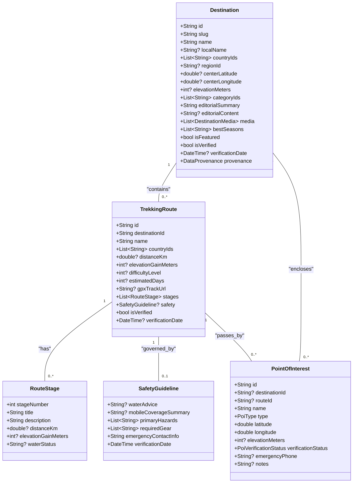
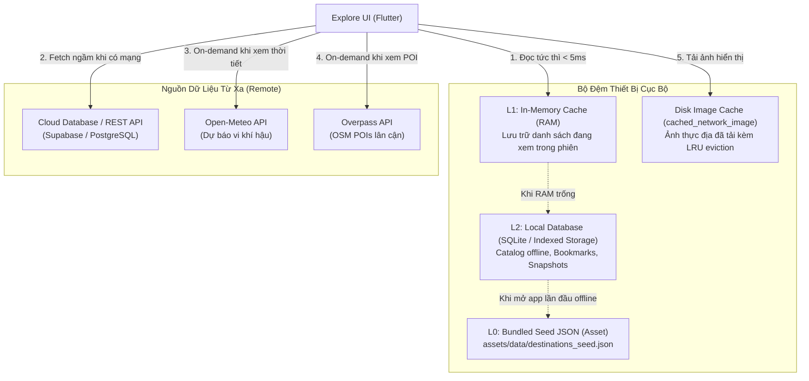

# KIẾN TRÚC DỮ LIỆU HYBRID & PHÂN HỆ KHÁM PHÁ (EXPLORE DATA ARCHITECTURE - REVISED)

> **Dự án:** TRAVEL_APP — Premium Global Travel Discovery Platform  
> **Phiên bản:** 2.0 (Kiến trúc phân tách thực thể & Hỗ trợ toàn cầu thực tế)  
> **Chiến lược cốt lõi:** HYBRID = CURATED CATALOG + LIVE DATA SERVICES + LOCAL PERSISTENCE  
> **Tiêu chí:** Tách bạch Destination / Route / POI, hỗ trợ xuyên quốc gia, phòng thủ dữ liệu an toàn dã ngoại.

---

## 1. PHÂN BIỆT RẠCH RÒI 3 THỰC THỂ CỐT LÕI (CORE ENTITY SEPARATION)

Trong phiên bản thiết kế ban đầu, "Điểm đến" (Destination) bị gộp chung với "Cung đường" (Route) và "Điểm tọa độ" (POI), dẫn đến việc gán ép mọi địa danh đều phải có cự ly đi bộ, độ khó leo núi và các chặng trekking. 

Kiến trúc chuẩn hóa phân tách rõ 3 thực thể này:



### 1.1. Thực thể `Destination` (Điểm đến / Địa danh du lịch)
- **Định nghĩa:** Một khu vực địa lý, thắng cảnh, vườn quốc gia hoặc thành phố du lịch (ví dụ: *Vườn quốc gia Phong Nha - Kẻ Bàng, Thị trấn Sa Pa, Quần thể Alps vùng Jungfrau, Vườn quốc gia Banff*).
- **Đặc điểm:** 
  - Không bắt buộc phải có cự ly đi bộ hay độ khó.
  - Có thể chứa 0, 1 hoặc nhiều cung đường trekking (`TrekkingRoute`).
  - Có thể nằm trong một quốc gia hoặc bao trùm nhiều quốc gia (`countryIds: ['FR', 'IT', 'CH']`).

### 1.2. Thực thể `TrekkingRoute` (Cung đường dã ngoại / Tuyến đi)
- **Định nghĩa:** Một tuyến đường thực địa cụ thể có điểm bắt đầu, điểm kết thúc, cự ly đo đạc, chênh lệch độ cao và các chặng đi (ví dụ: *Cung Tà Năng - Phan Dũng 55km, Tuyến leo Fansipan qua Trạm Tôn 11km, Tuyến Tour du Mont Blanc 170km*).
- **Đặc điểm:**
  - Có cự ly (`distanceKm`), độ cao đạt được (`elevationGainMeters`), độ khó (`difficultyLevel`: 1..4).
  - Có các chặng cụ thể (`RouteStage`) và hướng dẫn an toàn riêng (`SafetyGuideline`).
  - Cung đường Tour du Mont Blanc đi qua 3 quốc gia: Pháp, Ý, Thụy Sĩ.

### 1.3. Thực thể `PointOfInterest` (Điểm tiện ích & Cứu hộ)
- **Định nghĩa:** Một tọa độ điểm cụ thể trên bản đồ (ví dụ: *Đỉnh núi, Nguồn nước tự nhiên, Bãi cắm trại, Trạm kiểm lâm, Trạm y tế xã*).
- **Đặc điểm:** Luôn đi kèm trạng thái kiểm chứng (`UNVERIFIED_OSM`, `VERIFIED_FIELD`).

---

## 2. HỖ TRỢ ĐA QUỐC GIA & CUNG ĐƯỜNG XUYÊN BIÊN GIỚI (CROSS-BORDER ARCHITECTURE)

### 2.1. Phân cấp Địa lý Chuẩn mực
Khắc phục triệt để lỗi mô hình hóa "châu lục là vùng của một quốc gia":
```
Continents (Châu Lục: Asia, Europe, North America, South America, Oceania, Africa, Antarctica)
    │
    ▼
Countries (Quốc Gia: VN, JP, CH, FR, IT, NZ, US, CA...)
    │  - emergency_police, emergency_ambulance, emergency_fire, mountain_rescue
    │
    ▼
Regions / Administrative Zones (Vùng Miền: Miền Bắc, Tây Nguyên, Bang Valais, Bang Alberta...)
```

### 2.2. Xử lý Cung đường Xuyên Biên Giới (Cross-Border Routes)
- Các điểm đến và cung đường như **Dãy Alps**, **Tour du Mont Blanc**, hay **Tam giác Vàng** liên kết với nhiều quốc gia thông qua bảng trung gian quan hệ nhiều - nhiều (`destination_countries`, `route_countries`).
- **Trường `is_domestic`:** **Không lưu cứng dạng cột boolean trong cơ sở dữ liệu**. Trong ứng dụng Flutter, `is_domestic` được tính toán động (computed property):
  ```dart
  bool isDomestic(Destination dest, String userCountryCode) {
    return dest.countryIds.contains(userCountryCode);
  }
  ```
  Khi người dùng ở Việt Nam (`userCountryCode = 'VN'`), các điểm có chứa `'VN'` sẽ thuộc tab **Trong Nước**; các điểm khác sẽ thuộc tab **Quốc Tế**.

---

## 3. KIẾN TRÚC BỘ ĐỆM PHÂN CẤP (MULTI-TIER CACHE ARCHITECTURE)

Để đảm bảo ứng dụng hoạt động tin cậy khi người dùng đi vào rừng sâu mất kết nối mà không làm quá tải thiết bị:



### 3.1. Phân định vai trò các lớp lưu trữ
1. **L0 - Bundled Seed JSON (`assets/data/destinations_seed.json`):**
   - Đóng gói sẵn trong file cài đặt app (apk/ipa/web bundle).
   - Chứa catalog hạt nhân gồm ~15 điểm đến tuyển chọn chất lượng cao (cả Trong nước và Quốc tế).
   - Đảm bảo người dùng vừa cài app xong, tắt mạng ngay lập tức vẫn duyệt được điểm đến đầy đủ thông tin.
2. **L1 - In-Memory Cache (RAM State):**
   - Lưu trữ state hiện tại trong suốt phiên chạy của ứng dụng thông qua `ExploreController`.
3. **L2 - Local Structured Database (SQLite):**
   - Khi catalog mở rộng trên 50 điểm đến, sử dụng SQLite để truy vấn có chỉ mục, lưu vết điểm đến đã tải, lịch sử tìm kiếm và bookmark cá nhân.
   - **Tuyệt đối không dùng SharedPreferences làm database lưu trữ catalog điểm đến.** SharedPreferences chỉ dùng lưu key-value cấu hình người dùng (app settings, theme, user country code).
4. **Image Disk Cache (`cached_network_image`):**
   - Tự động lưu cache ảnh xuống bộ nhớ máy, có giới hạn dung lượng và cơ chế xóa ảnh cũ (LRU - Least Recently Used).

---

## 4. QUY TẮC THỜI HẠN HIỆU LỰC & ĐỘ CŨ DỮ LIỆU (TTL & STALENESS RULES)

Mỗi loại dữ liệu dã ngoại có tốc độ biến đổi khác nhau, do đó phải có quy tắc hết hạn (TTL) và độ cũ (Staleness) hoàn toàn riêng biệt:

| Phân Loại Dữ Liệu | Nguồn Cung Cấp | TTL Hiệu Lực | Ngưỡng Cảnh Báo Cũ (Stale) | Xử Lý Khi Mất Mạng (Offline Fallback) |
| :--- | :--- | :--- | :--- | :--- |
| **Dự báo thời tiết vi khí hậu** | Open-Meteo API | **30 phút** | **> 1 giờ** | Hiển thị snapshot cũ kèm nhãn: *"Dữ liệu lúc [HH:mm] (Cũ)"*. Cảnh báo không dùng dữ liệu cũ để quyết định vượt suối lũ. |
| **POI lân cận (Nguồn nước, cứu hộ)** | Overpass API (OSM) | **24 giờ** | **> 7 ngày** | Hiển thị danh bạ cứu hộ khẩn cấp quốc gia lưu sẵn trong app. |
| **Nội dung biên tập điểm đến / lộ trình**| Chuyên gia dã ngoại | **7 ngày** | **> 30 ngày** | Đọc từ L2 Database hoặc Seed JSON L0. Dữ liệu biên tập an toàn có thể dùng offline vĩnh viễn. |
| **Hình ảnh thực địa** | CDN / Wikimedia | **30 ngày** | **> 90 ngày** | Hiển thị ảnh từ disk cache; nếu chưa tải thì hiển thị ảnh asset dự phòng. |
| **Tọa độ & Đường đồng mức GIS** | Ban quản lý / GIS | **30 ngày** | **> 180 ngày** | Sử dụng bản đồ offline lưu trên máy. |

---

## 5. CHÍNH SÁCH BẢO VỆ AN TOÀN SINH TỒN THỰC ĐỊA (FIELD SAFETY POLICY)

1. **Nguồn nước:**
   - Dữ liệu nguồn nước từ OpenStreetMap (`amenity=drinking_water`, `natural=spring`) **tuyệt đối không được mô tả là "Nước sạch uống ngay"**.
   - Bắt buộc gắn khuyến cáo: *"Nguồn nước tự nhiên chưa kiểm định vi sinh. Bắt buộc đun sôi tối thiểu 3 phút hoặc xử lý qua màng lọc 0.1 micron + viên khử trùng Aquatabs."*
2. **Cơ sở cứu hộ:**
   - Trạm kiểm lâm hoặc trạm y tế trên bản đồ phải có nhãn trạng thái: *"Trạm thực địa (Chưa xác minh có người trực 24/7)"*.
3. **Số điện thoại khẩn cấp:**
   - Tự động hiển thị số cứu hộ của **quốc gia sở tại** của điểm đến (Thụy Sĩ: 1414 REGA; Mỹ: 911; Nhật Bản: 110/119; Việt Nam: 114/115/kiểm lâm địa phương).
   - Không hiển thị số hotline Việt Nam cho điểm đến ở nước ngoài.
4. **Dự báo thời tiết:**
   - Dán nhãn minh bạch: *"Dự báo mô hình toán học (Open-Meteo) • Không phải trạm quan trắc mặt đất tại chỗ"*.
   - Khuyến cáo: Dự báo thời tiết không đảm bảo loại trừ hoàn toàn nguy cơ lũ quét, sét đánh hay sạt lở cục bộ ở các khe suối hẹp.
