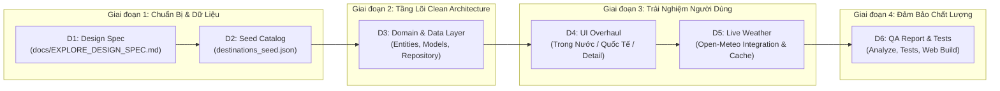

# LỘ TRÌNH THỰC THI & PHÂN BỔ NGUỒN LỰC KỸ THUẬT (EXPLORE IMPLEMENTATION ROADMAP - REVISED)

> **Dự án:** TRAVEL_APP — Premium Global Travel Discovery Platform  
> **Phiên bản:** 2.0 (Ước lượng thực tế, phân rã công việc chi tiết và kiểm soát rủi ro độc lập)  
> **Nguyên tắc hành động:** Chia nhỏ thành các sản phẩm bàn giao (Deliverables) có thể kiểm thử độc lập, không phá vỡ mã nguồn hiện có, không can thiệp backend khi chưa phê duyệt.

---

## 1. ĐÁNH GIÁ LẠI NỖ LỰC TRIỂN KHAI THỰC TẾ (REALISTIC EFFORT RE-ESTIMATION)

Trong phiên bản trước, ước tính sơ bộ 14–16 giờ là **quá lạc quan** và chưa phản ánh đúng khối lượng công việc thực tế của một nền tảng du lịch đạt chuẩn thương mại. Việc nghiên cứu dữ liệu thực tế (tọa độ, ảnh có giấy phép Creative Commons, số khẩn cấp theo từng quốc gia, lộ trình trekking chuẩn xác) đòi hỏi thời gian kiểm duyệt kỹ lưỡng.

Bảng phân rã công việc chi tiết (Work Breakdown Structure - WBS):

| Gói Công Việc (Deliverable) | Nội Dung Chi Tiết | Giả Định Kỹ Thuật (Assumptions) | Ước Tính Nỗ Lực |
| :--- | :--- | :--- | :---: |
| **D1: Design Specification** | Hoàn thiện `docs/EXPLORE_DESIGN_SPEC.md`: Hệ màu, Typography, Segmented Control Trong Nước/Quốc Tế, Bento Grid, Spacing 8pt. | Sử dụng Design Tokens hiện có trong `AppTheme` làm gốc. | **3 – 4 giờ** |
| **D2: Curated Seed Catalog** | Xây dựng file `assets/data/destinations_seed.json` chuẩn hóa: 10 điểm đến VN (5 vùng miền) và 6 điểm đến quốc tế (6 châu lục) kèm ảnh bản quyền mở, tọa độ chuẩn, lộ trình và an toàn riêng biệt. | Dữ liệu được biên tập thủ công, xác minh tọa độ và giấy phép ảnh trước khi nạp vào JSON. | **6 – 8 giờ** |
| **D3: Domain & Data Layer** | Triển khai Entities (`Destination`, `TrekkingRoute`, `PointOfInterest`, `SafetyGuideline`), Models (`fromJson`/`toJson`), `ExploreLocalDataSource`, `ExploreRepositoryImpl`, và Unit Tests cho tầng dữ liệu. | Tầng LocalDataSource đọc trực tiếp từ Seed JSON và lưu cache in-memory/prefs an toàn. | **8 – 10 giờ** |
| **D4: Presentation Layer** | Xây dựng `ExploreController` (ChangeNotifier), nâng cấp `ExploreScreen` (chuyển tab Trong nước/Quốc tế, lọc vùng miền, Bento grid), và đại tu `DestinationDetailScreen` (lộ trình thực tế, an toàn riêng biệt, số cứu hộ theo quốc gia). | Sử dụng animation có sẵn (`flutter_animate`, `animations`), giao diện responsive trên mobile và web. | **10 – 12 giờ** |
| **D5: Live Weather & Safety** | Tích hợp `Open-Meteo` vào Explore Detail và Hero Card với bộ đệm RAM 30 phút, nhãn minh bạch thời điểm lấy, xử lý lỗi mất mạng an toàn. | Kế thừa `WeatherService` hiện có, bổ sung cơ chế throttle và cache. | **4 – 5 giờ** |
| **D6: QA, Test & Báo Cáo** | Chạy `flutter test` (bổ sung test case cho đa quốc gia và repository), `flutter analyze` (0 issues), kiểm thử build web release, lập `docs/EXPLORE_QA_REPORT.md`. | Môi trường Flutter 3.13+ trên máy hoạt động ổn định. | **5 – 6 giờ** |
| **TỔNG NỖ LỰC TOÀN BỘ** | **6 Deliverables Độc Lập** | **Tổng thời gian phân bổ cho 1 Sprint hoàn chỉnh** | **36 – 45 giờ** |

---

## 2. KẾ HOẠCH BÀN GIAO THEO TỪNG GIAI ĐOẠN ĐỘC LẬP (PHASED DELIVERABLES)

---

## 3. DANH SÁCH FILE VÀ PHẠM VI TÁC ĐỘNG

### 3.1. Các file tạo mới (New Files)
1. `mobile_flutter/assets/data/destinations_seed.json` (Catalog hạt nhân Trong nước & Quốc tế).
2. `mobile_flutter/lib/features/explore/domain/entities/destination.dart`
3. `mobile_flutter/lib/features/explore/domain/entities/trekking_route.dart`
4. `mobile_flutter/lib/features/explore/domain/entities/point_of_interest.dart`
5. `mobile_flutter/lib/features/explore/domain/entities/safety_guideline.dart`
6. `mobile_flutter/lib/features/explore/domain/entities/destination_media.dart`
7. `mobile_flutter/lib/features/explore/domain/repositories/i_explore_repository.dart`
8. `mobile_flutter/lib/features/explore/domain/usecases/get_destinations_usecases.dart`
9. `mobile_flutter/lib/features/explore/data/models/destination_model.dart`
10. `mobile_flutter/lib/features/explore/data/models/trekking_route_model.dart`
11. `mobile_flutter/lib/features/explore/data/datasources/explore_local_datasource.dart`
12. `mobile_flutter/lib/features/explore/data/repositories/explore_repository_impl.dart`
13. `mobile_flutter/lib/features/explore/presentation/controllers/explore_controller.dart`
14. `mobile_flutter/lib/features/explore/presentation/widgets/explore_tab_bar.dart`
15. `mobile_flutter/lib/features/explore/presentation/widgets/region_chip_filter.dart`
16. `docs/EXPLORE_DESIGN_SPEC.md`
17. `docs/EXPLORE_DESIGN_DECISIONS.md`
18. `docs/EXPLORE_QA_REPORT.md`

### 3.2. Các file nâng cấp, chỉnh sửa (Modified Files)
1. `mobile_flutter/pubspec.yaml` (Khai báo asset `assets/data/`).
2. `mobile_flutter/lib/features/explore/presentation/screens/explore_screen.dart` (Kết nối Controller/Repository, hỗ trợ Trong nước & Quốc tế).
3. `mobile_flutter/lib/features/explore/presentation/screens/destination_detail_screen.dart` (Hiển thị lộ trình và an toàn theo từng điểm đến, số cứu hộ theo quốc gia).
4. `mobile_flutter/lib/core/models/outdoor_image.dart` (Bổ sung metadata bản quyền mở).
5. `mobile_flutter/test/widget_test.dart` (Cập nhật kịch bản kiểm thử).

### 3.3. Các module tuyệt đối không chỉnh sửa (Protected Modules)
- `mobile_flutter/lib/features/offline_map/**` (Bản đồ ESRI và GPS đang hoạt động tốt).
- `mobile_flutter/lib/features/safety/**` (SOS khẩn cấp, mã Morse và còi báo động).
- `mobile_flutter/lib/features/trip_planner/**` (Lập kế hoạch và dự toán chi phí).
- `mobile_flutter/lib/features/outdoor_skills/**` (10 bài cẩm nang sinh tồn).

---

## 4. QUY TẮC AN TOÀN VÀ PHÊ DUYỆT (EXECUTION SAFETY RULES)

- Không tự ý commit Git hoặc đẩy lên remote `main` khi chưa hoàn thành kiểm thử và được người dùng đồng ý.
- Không deploy backend hoặc tạo database thực tế khi đang ở giai đoạn hoàn thiện client seed data.
- Không đưa bất kỳ API secret nào vào mã nguồn Flutter.
- Mọi thay đổi mã nguồn phải vượt qua `flutter analyze` (0 issues) và `flutter test` (100% pass) trước khi báo cáo hoàn tất.
